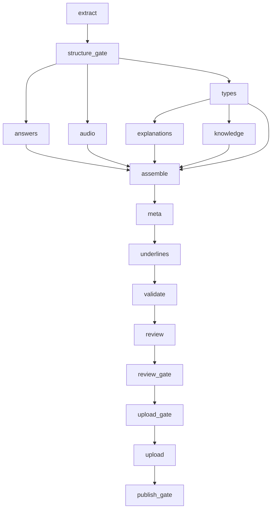
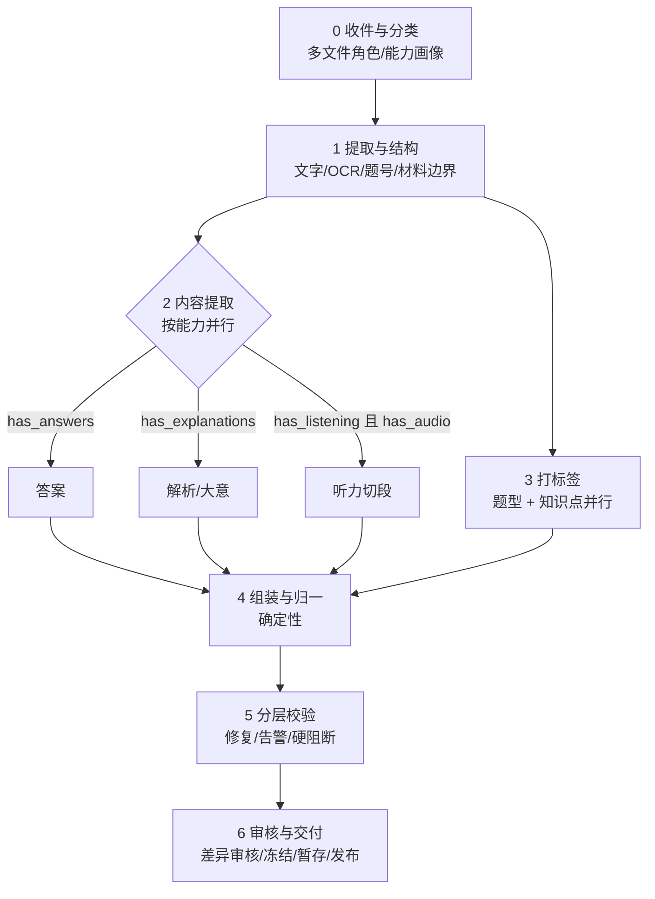

# 上传流程重新设计（2026-11-06）

本文先核对现有流程的真实依赖与并行关系，再给出一套按试卷特征自动裁剪的新流程。

## 一、现有流程核对

阶段定义在 `workflow/contracts.py`，调度在 `workflow/auto.py`，状态在 `workflow/manifest.py`。

### 1. 16 个阶段与依赖

| 阶段 | 类型 | 依赖 | 产物 | 说明 |
| --- | --- | --- | --- | --- |
| extract | command | — | 正文、结构、提取报告、元信息 | Word 原生 / PDF 文字层或 OCR，保留表格、图片、位置 |
| structure_gate | gate | extract | structure.confirmed.json | 模型确认题号、题组、材料边界；缺失只留警告 |
| answers | agent | structure_gate | 01_source_ans/answers.json | 有答案才提取，无答案给空映射 |
| audio | agent（optional） | structure_gate | 02_audio/audio_map.json | 听力切段；无听力可跳过 |
| types | agent | structure_gate | 03_types/types.json | 主类、子类、词数、内容完整性 |
| explanations | agent | types | 04_knowledge/explanations.json | 原解析/文章大意提取；缺失填「无」 |
| knowledge | agent | types | 04_knowledge/knowledge.json | 知识点与教材匹配 |
| assemble | agent | audio + types + knowledge + explanations | 06_batch/batch.json | 合并为正式批次；现已加确定性回填 |
| meta | command | assemble | batch_meta.base.json | 难度保留/补默认，分类 |
| underlines | command（optional） | meta | batch_meta.json | docx 画线；无 docx 跳过 |
| validate | gate | underlines | validation-report.json | 19 项只读体检 |
| review | agent | validate | review-rounds、人工队列等 | 标签重判、抽样复核 |
| review_gate | gate | review | review-gate.json | 阻断项/人工队列/必检项 |
| upload_gate | human | review_gate | — | 人工确认批次、目标、冻结请求 |
| upload | command | upload_gate | receipt.json | 提交远端上传暂存 |
| publish_gate | human | upload | — | 发布，永不自动 |

### 2. 实际并行关系



- `structure_gate` 确认后，`answers / audio / types` 是第一并行批。
- `types` 完成后，`explanations / knowledge` 是第二并行批。
- `assemble` 不参与并行，是确定性合并。
- `meta → underlines → validate → review` 基本串行。
- 当前零人工模式：audio 候选切片自动接受；validate/review_gate 未过也继续；upload_gate/publish_gate 直接 skipped。

### 3. 现有跳过条件（关键）

- `audio`：批次内有 `02_audio/SKIP_LISTENING`，或已确认结构的所有单元都有明确题型且没有「听力」类。
- `underlines`：无 docx 时跳过。
- `answers`、`explanations`：**声明为必选 agent，不因“没有答案/没有解析”跳过**，只靠提示词让模型输出空映射/「无」。
- 其余阶段没有输入形态跳过。

这就是现在“各种试卷都走同一套 16 步”的根本原因：**流程是固定图，不是按试卷能力裁剪的图**。

## 二、现流程的主要问题

1. **可选内容仍占阶段**：没有答案/解析的卷子仍会调用对应模型；失败会被记成阶段失败，制造假卡点。
2. **听力只有“全卷无听力”才跳过**：听力卷但没有音频、或部分单元题型缺失时，仍进入 audio，错误类型多。
3. **整批失败粒度太粗**：一个单元题干/选项/表格错误会让 assemble 整批失败；应隔离单元。
4. **校验没有分层**：可自动修复、可告警、真正阻断混在一起，gate 一失败就重跑整批。
5. **上传依赖人工运维**：媒体部署、隧道、上传暂存、发布分散，流程图上没有表达清楚。
6. **并行只看依赖，不看能力**：answers/explanations 即使没有输入也进入并行批，浪费调用。

## 三、新流程设计：按“批次能力画像”裁剪的 DAG

核心思想：**先识别这份卷子有什么，再决定跑哪些阶段。**

### 1. 批次能力画像 `batch-profile.json`

在 extract 后生成（确定性规则 + 模型确认，只记录证据，不作为硬阻断）：

| 字段 | 取值 | 用途 |
| --- | --- | --- |
| has_listening | true/false/unknown | 是否跑听力结构相关逻辑 |
| has_audio | true/false | 是否切段、是否要音频附件 |
| has_answers | true/false | 是否跑答案提取 |
| has_explanations | true/false | 是否跑解析/大意提取 |
| has_tables | true/false | 是否需要表格保真与校验 |
| has_images | true/false | 是否需要媒体清单/部署 |
| has_writing | true/false | 书面表达特殊处理 |
| source_kind | 真题/模拟/同步/单元/原创/... | 决定是否做教材匹配 |
| lesson_synced | true/false | 仅同步练习/单元测验做 textbook placement |
| file_roles | paper/answers/explanations/mixed/audio | 多文件角色 |

### 2. 新阶段分组（6 个阶段，内部子任务）



| 新阶段 | 包含的旧阶段 | 执行方式 |
| --- | --- | --- |
| 0 收件与分类 | extract 的卷头/文件角色识别 | 确定性规则 + 模型兜底 |
| 1 提取与结构 | extract + structure_gate | 提取串行，结构确认一次 |
| 2 内容提取 | answers + explanations + audio | 有输入才跑；三者可并行 |
| 3 打标签 | types + knowledge | 两个 worker 并行；knowledge 只在 lesson_synced 时做教材匹配 |
| 4 组装与归一 | assemble + meta + underlines | 全部确定性；模型不写题干/选项/答案 |
| 5 分层校验 | validate | 修复层 → 告警层 → 硬阻断层 |
| 6 审核与交付 | review + review_gate + upload_gate + upload + publish_gate | 差异审核 → 冻结 → 暂存 → 发布 |

### 3. 能力矩阵（不同试卷怎么走）

| 试卷形态 | 答案 | 解析 | 听力 | 题型/知识点 | 组装 | 结果 |
| --- | --- | --- | --- | --- | --- | --- |
| 标准中考卷（有听力、答案、解析） | ✅ | ✅ | ✅ | ✅ | ✅ | 全流程 |
| 无听力卷 | ✅ | ✅ | ⏭️ | ✅ | ✅ | 跳过 audio |
| 有听力但没音频 | ✅ | ✅ | ⚠️ audio_absent | ✅ | ✅ | 不切段，记缺音频 |
| 无答案卷 | ⏭️ | 按需 | 按需 | ✅ | ✅ | 答案字段空 |
| 无解析卷 | 按需 | ⏭️ | 按需 | ✅ | ✅ | 解析填「无」 |
| 只有正文图片 | ⏭️ | ⏭️ | 按需 | ✅ | ✅ | OCR 后继续 |
| 同步练习/单元测验 | 按需 | 按需 | 按需 | ✅ + 教材匹配 | ✅ | 加 textbook placement |
| 多文件（正文+答案+解析） | ✅ | ✅ | 按需 | ✅ | ✅ | 按角色合并 |

### 4. 新状态模型

不再用“failed”表达“这份卷没有这个输入”：

| 状态 | 含义 |
| --- | --- |
| not_applicable | 该卷没有这个能力/输入，正常跳过 |
| pending / running | 等待/执行中 |
| completed | 产物完整 |
| degraded | 有产物但证据不足（如候选音频、缺解析） |
| needs_review | 有具体差异待处理 |
| failed | 只有可重试的真实错误 |
| blocked | 只有数据损坏/不可恢复才用 |

批次最终状态只保留：`processing`、`ready_for_review`、`ready_for_upload`、`pending_confirmation`、`published`、`blocked`（真实损坏）。

### 5. 校验分层

| 层 | 例子 | 处理 |
| --- | --- | --- |
| 自动修复 | 题干/选项抄错、空档写法、表格 variant、A–G 选项位置 | 确定性回填，不阻断 |
| 告警 | 缺难度、缺解析、缺 location/version、能力受限（看不到图/听不到音频） | 记录，继续 |
| 硬阻断 | 题干/选项在原卷中完全找不到、题号覆盖缺失、表格结构丢失 | 隔离到单元，其余继续 |
| 人工 | 知识点差异、答案/解析/原文实质冲突 | 只把这些题送审 |

关键变化：**硬阻断只影响具体单元，不再让整批 assemble/validate 失败**；批次可以带 `degraded` 单元完成。

### 6. 审核与交付边界

- 自动审核只输出“差异题”队列；能力受限项 informational，不进队列。
- `upload` 前只做两件事：冻结 payload、确认媒体已部署（缺媒体可显式选择“暂不附件”）。
- `upload_gate` 仍是人工入口；插件可自动跑到 `pending_confirmation`，不自动发布。
- 发布始终人工。

## 四、当前确定的执行顺序

结构阶段只负责把原卷关系理清：题号、单题/组题、题干、共享材料、选项、题型边界和 Word/PDF 对应关系。结构候选形成后，以下工作同时进行，不互相等待：

```text
结构关系候选
  ├─ 答案匹配
  ├─ 解析/文章大意匹配
  ├─ 听力音频切分（有音频才切）
  ├─ 题型与子类识别
  ├─ 知识点标签
  └─ 难度判断
        ↓
批次组装（按云端字段结构合并）
        ↓
结构/版面/下划线/表格/媒体体检
        ↓
审核差异整理
        ↓
人工确认后提交上传暂存
```

书面表达无印刷题号时，先按上一题顺延；这只影响最终展示/上传字段，不阻断音频、题型、知识点或其他题目的处理。只有题干、材料、选项与原卷无法对应时，才阻断对应题目，不能把局部问题扩散为整卷停止。

## 四、落地步骤（建议）

1. **第一步：能力画像 + 跳过规则**（低风险）
   - 新增 `01_source/batch-profile.json`。
   - `answers`/`explanations` 改为 optional；无输入时 `not_applicable`。
   - audio 增加 `has_audio=false` 的 `audio_absent` 分支。
2. **第二步：调度按能力裁剪**
   - contracts 增加 `when`/`requires_capability`；auto 只调度满足条件的阶段。
   - 并行批按能力分组，不再固定四路。
3. **第三步：校验分层与单元隔离**
   - validate 输出 `repairable / advisory / blocking` 三层。
   - assemble/validate 失败只标记单元，批次继续。
4. **第四步：交付段独立**
   - 媒体清单与部署状态进入 `07_upload/media-plan.json`。
   - upload_gate 之前不再混入内容校验。

## 五、已确认规则（2026-11-06）

1. **听力卷但没有音频**：继续，不切段，记 `audio_absent`，不阻断。
2. **没有答案/没有解析**：继续，不阻断；答案/解析按空值记录，后续可补填。
3. **硬阻断单元**：带 `degraded`/待处理标记继续，不因单个单元停整批。
4. **上传**：暂不自动提交，保持人工上传入口；流程只自动到本地 `pending_confirmation` 前。

## 六、当前已落地的第一步

- `answers` 改为可选：无答案来源（`01_source_ans/正文.txt`、`01_source/附录.txt`、附件答案文本均无内容）时自动跳过并记备注，答案留空继续。
- `explanations` 改为可选：没有任何「解析/文章大意」标记时自动跳过，并写一份确定性空产物（全部「无」），装配照常继续。
- `audio` 增加 `no_audio` 分支：有听力题但未提供音频时跳过切段，记「未提供音频，按无音频继续（audio_absent）」。
- 无解析/无答案的卷子不再因对应阶段失败而阻断整批。
- 上传仍保持手动确认，不自动提交。

后续第二、三步（能力画像文件、校验分层与单元隔离）按本文方案继续实施。
